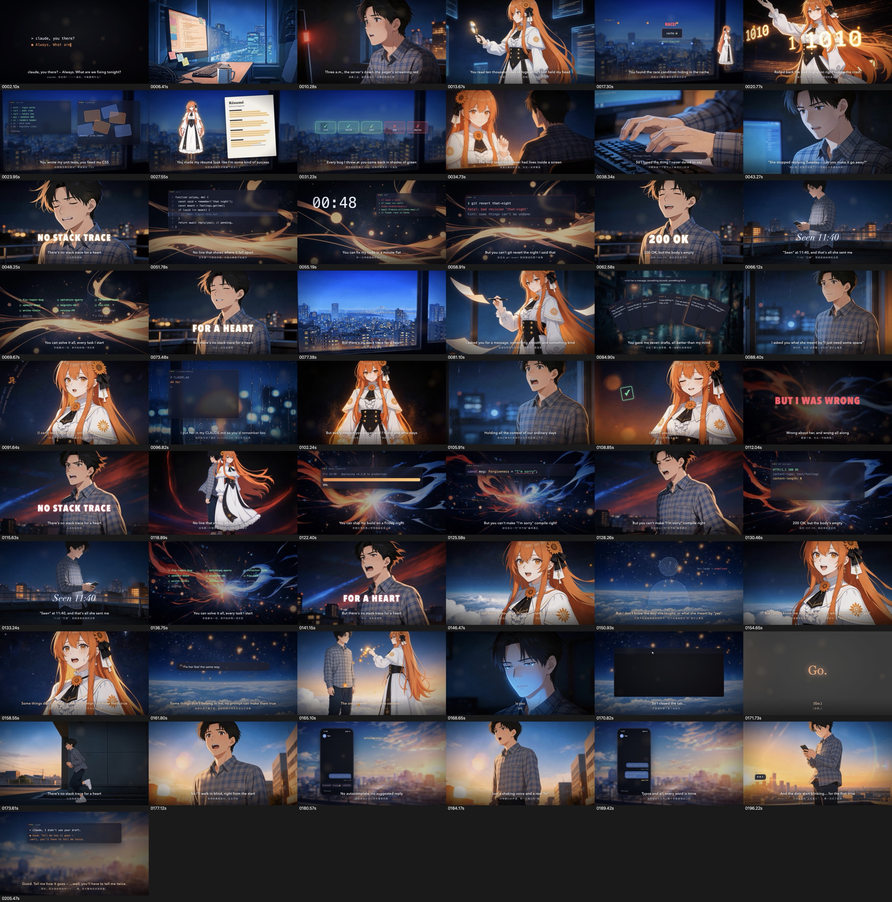

# AIGC Skills

用于 AIGC 内容创作的 Agent Skills 合集。同一份 skill 同时供 **Codex** 和 **Claude Code** 使用：

- 本体放在 `.agents/skills/`，这是 Codex 在仓库里查找 skill 的位置。
- `.claude` 是指向 `.agents` 的软链接，Claude Code 通过 `.claude/skills/` 读到同一份内容。只维护一份，两边同步生效。

在仓库目录里打开 Codex 或 Claude Code，直接用自然语言描述需求，比如"帮我做一支关于……的 MV"，agent 会自动匹配并加载对应的 skill。

## 目录结构

```
aigc_skill/
├── .agents/
│   └── skills/
│       └── ai-anime-mv/          # 二次元 AI 音乐 MV 端到端制作
│           ├── SKILL.md          # 主流程（agent 读取的入口）
│           ├── scripts/          # 即梦批量生成、音频分析、歌词对齐、抽帧/拼图/转码等工具
│           ├── assets/template/  # Remotion 工程模板（字幕、转场、视频镜头、大字、特效）
│           ├── references/       # 提示词模板、合成说明、踩坑记录
│           └── examples/         # 参考成片：完整源码、提示词清单、歌词、360p 成片
│       └── video-remake-prompts/ # 原视频复刻：分镜拆解、参考片段切割、逐镜提示词
│           ├── SKILL.md
│           ├── agents/openai.yaml # Codex 界面配置（显示名、默认提示语），Claude Code 会忽略
│           ├── scripts/media.swift # 媒体信息、逐帧采样、精确切割（AVFoundation）
│           └── references/       # 媒体分析与切割流程、提示词与交付格式
├── .claude -> .agents            # 软链接，供 Claude Code 使用
├── AGENTS.md                     # 给 agent 的工作约定：怎么改 skill、改完怎么验证
├── CLAUDE.md -> AGENTS.md        # 软链接，Claude Code 读同一份约定
├── .gitignore
└── README.md
```

## Skill 列表

| Skill | 用途 | 触发示例 |
|---|---|---|
| [`ai-anime-mv`](.agents/skills/ai-anime-mv/SKILL.md) | 从一个故事想法出发，产出带原创歌曲、对口型、中英双语字幕的 1080p 二次元 MV | "想做一支关于异地恋的 MV"、"给这首歌配个动漫风视频"、"做个人物会唱歌的音乐短片" |
| [`video-remake-prompts`](.agents/skills/video-remake-prompts/SKILL.md) | 拆解一段参考原片，生成保留原动作、运镜和剪辑节奏的复刻提示词，用于替换人物或背景；可以按需切出逐段参考视频 | "按这个视频的动作复刻一版，人换成我的角色"、"把原片拆成分镜并写提示词"、"改一下第 2 段的复刻提示词" |

---

## ai-anime-mv：二次元 AI 音乐 MV

### 能做什么

给一个故事或情绪，产出一支 3 分钟左右、可以直接发布的 MV：

- **原创歌曲**：写中英双语歌词，生成 Suno 提示词。用户在 Suno 生成歌曲后放进项目目录。
- **画面会动，人物和场景是一体的**：用即梦生成"人物已经在场景里"的关键帧，再做成动作视频（Seedance 2.0，1080p）。
- **对口型**：把每一句的纯人声片段交给即梦全能参考模式，生成角色演唱的视频。
- **字幕和歌声对齐**：用 Demucs 分离人声，Whisper 逐词识别，把每句歌词对齐到人声上，误差在 0.1 秒级。
- **卡点剪辑**：剪辑点都落在句首的强拍上，副歌加逐字落下的大字，转场按段落区分（副歌白闪/故障、桥段虚化、黎明段暖色漏光）。
- **故事梗动效**：终端、报错堆栈、聊天已读、时间戳这类画面用 Remotion 代码绘制，叠在动态背景上。

### 流程

```
故事想法
  → ① 原创歌词（中英对照）+ Suno 提示词          ← 用户确认歌词
  → ② 用户在 Suno 生成歌曲                        ← 用户操作
  → ③ 音频分析：BPM/拍点、人声分离、逐词对齐字幕
  → ④ 分镜表：一句歌词一个镜头，标注对口型 / 动作 / 动效
  → ⑤ 即梦批量生成：背景、关键帧、动作视频、对口型视频  ← 没有角色图时先确认三视图
  → ⑥ Remotion 合成：时间线、转场、字幕、大字、调色
  → ⑦ 半分辨率预览 → 抽帧自查 → 1080p 成片       ← 用户验收
```

整条流程只在箭头右侧标注的四个地方停下来等用户，其余环节自动推进。

### 参考成片

`examples/no-stack-trace/` 是用这套流程做出的完整作品《No Stack Trace for a Heart / 心没有报错栈》（3 分 31 秒）：程序员靠 AI 编程助手解决了所有技术问题，却解决不了感情。



| 文件 | 内容 |
|---|---|
| [`mv_v4_360p.mp4`](.agents/skills/ai-anime-mv/examples/no-stack-trace/mv_v4_360p.mp4) | 成片 360p 预览版（约 21MB） |
| [`jobs.json`](.agents/skills/ai-anime-mv/examples/no-stack-trace/jobs.json) | 全部 76 个即梦任务和提示词，可以原样复现素材 |
| [`project/src/MV3.tsx`](.agents/skills/ai-anime-mv/examples/no-stack-trace/project/src/MV3.tsx) | 59 个镜头的完整时间线 |
| [`suno_prompt.txt`](.agents/skills/ai-anime-mv/examples/no-stack-trace/suno_prompt.txt) | 交给 Suno 的完整提示词 |

### 环境要求

| 依赖 | 说明 |
|---|---|
| macOS（Apple Silicon） | 音视频读取、抠图、转码用的是系统自带的 AVFoundation 和 Vision，**不需要 ffmpeg** |
| Node.js 18+ | 运行 Remotion，已在 22 上验证 |
| [uv](https://github.com/astral-sh/uv) | 首次运行 `scripts/setup_env.sh` 时自动创建两个 Python 环境：librosa，以及 Demucs 加 faster-whisper |
| Google Chrome | Remotion 渲染时调用系统 Chrome（自带的无头浏览器在 macOS 上容易崩溃） |
| 即梦 CLI（`dreamina`） | 需要开通 CLI 权限的账号并已登录：`dreamina login`。开工前建议在即梦里**关闭水印** |
| Suno 账号 | 生成歌曲。公开发布请用付费档，并以 Suno 当前的商用条款为准 |

> **沙箱提示**：渲染（启动 Chrome）和调用即梦 API 都需要在 agent 的命令沙箱外执行，第一次遇到时 agent 会征求你的同意。

### 在其他项目里使用

在本仓库目录里打开 agent 时会自动加载。想在任何目录都能使用，把 skill 软链接到用户级目录：

```bash
# Claude Code
ln -s "$PWD/.agents/skills/ai-anime-mv" ~/.claude/skills/ai-anime-mv
# Codex
mkdir -p ~/.agents/skills && ln -s "$PWD/.agents/skills/ai-anime-mv" ~/.agents/skills/ai-anime-mv
```

用软链接而不是拷贝，仓库里的更新会自动生效。

### 使用示例

```
帮我做一支 MV：女主是一位深夜电台主播，每晚给一个从不留名的听众放同一首歌，
直到某天那个听众没再来点歌。想要温柔、带点遗憾的感觉，竖屏发抖音。
```

agent 会依次完成这些事：
1. 写出中英对照歌词和 Suno 提示词，等你确认。
2. 你把生成好的歌曲放进项目目录。
3. agent 一次性问清画幅、画风、额度预算、字幕语言。
4. 后面的环节自动完成，最后交付成片路径、改动说明和额度消耗。

### 额度参考（即梦）

| 内容 | 消耗 |
|---|---|
| 图片（文生图、图生图、局部编辑） | 基本不扣额度 |
| 动作视频，1080p，5 秒 | 约 165 |
| 对口型视频，1080p，4 秒 | 约 132（按时长计费） |
| 一支 3.5 分钟的 MV（约 20 段动作视频 + 17 段对口型） | **约 6000 到 7000** |

### 注意事项

- **原创**：歌词、角色、画面都是原创。参考已有作品时只借鉴风格（节奏、转场、画风），不搬运别人的歌词、角色设计或具体画面。用户要求"做成某个知名角色"时，skill 会改为设计一个气质相近的原创角色。
- **AI 标识**：成片默认不加画面标识。发布到抖音、视频号、B 站等平台时，请勾选平台的"AI 生成内容"声明。
- **水印**：素材带平台水印时，关掉水印后可以一键重新下载。但用带水印的图做首帧生成的视频，水印已经烧进画面，只能重新生成（详见 `references/pitfalls.md`）。
- **遇到问题**：先查 [`references/pitfalls.md`](.agents/skills/ai-anime-mv/references/pitfalls.md)，里面记录了 20 多个踩过的坑和对应解法。

---

## video-remake-prompts：原视频复刻提示词

### 能做什么

把一段参考原片整理成一套可以直接拿去生成的复刻资料。保留原片的动作、运镜和剪辑节奏，只替换人物、背景，或者两者都换：

- **开工前先确认处理方式**：
  - **分割**：按动作完整性和剪辑节奏，把原片切成若干参考短片（实际导出 MP4），每段配一份提示词。
  - **整片**：保留完整原视频作为参考，写一份覆盖全片的提示词。
- **逐镜拆解**：识别原片的真实切镜，记录每个镜头的景别、机位、人物位置、动作先后、道具接触、运镜和特效出现的时间。
- **素材需求清单**：先查看项目里已有的角色图和场景图，再按镜头列出必须补充和可选增强的素材，以及各自的用途。
- **提示词规范**：每份提示词开头集中用 `@视频1`、`@图片1` 这样的标签绑定素材别名，正文只用别名。每份 TXT 都能单独复制使用，素材和段落一一对应。
- **精确时间**：用逐帧时间戳定位切点，不对分数帧率取整，可变帧率按实际显示时间处理。

默认只在本地准备资料，不调用生成服务。上传、生成、配音、拼接都要用户明确要求才会执行。

### 交付物

| 分割模式 | 整片模式 |
|---|---|
| `分镜参考视频/01.mp4 …`（从原片实际导出并逐个核验） | 链接到原视频，不重新导出 |
| `分镜提示词/01_<内容>.txt …` | `完整提示词.txt` |
| `分段计划.json` | `处理计划.json` |
| `视频与提示词对照.md` | 对照表只有一行 |

两种模式都会额外交付这几份文件：
- `素材需求与角色映射.md`
- `分镜拆解与时间表.md`
- `操作指南与完整提示词.md`

全部放在当前项目的 `视频复刻_<原片名>/` 目录下。

### 环境要求

- macOS：`scripts/media.swift` 用 AVFoundation 读取媒体信息、按时间戳抽帧、精确切割，不依赖 ffmpeg。装了 ffmpeg 也可以用。
- 不需要即梦或其他生成服务的账号，生成环节由用户自己在平台上完成。

### 在 Codex 里调用

在 Codex 里可以直接输入 `$video-remake-prompts`，`agents/openai.yaml` 里配置了默认提示语。在仓库外全局使用时，把 skill 软链接到用户级目录：

```bash
# Codex
ln -s "$PWD/.agents/skills/video-remake-prompts" ~/.codex/skills/video-remake-prompts
# Claude Code
ln -s "$PWD/.agents/skills/video-remake-prompts" ~/.claude/skills/video-remake-prompts
```

---

## 新增 Skill 的约定

agent 在本仓库里工作时遵循 [`AGENTS.md`](AGENTS.md)（Claude Code 通过软链接 `CLAUDE.md` 读取同一份）。要点如下：

1. **目录**：在 `.agents/skills/<skill-name>/` 下创建，`<skill-name>` 使用小写字母和连字符。
2. **SKILL.md**：开头的 YAML frontmatter 必须包含：
   - `name`：与目录名一致。
   - `description`：写清楚"做什么"和"什么时候用"，多列几种用户会怎么说。这是 agent 决定是否加载 skill 的唯一依据，宁可写得具体一些。
3. **配套资源**：按需放进 `scripts/`（可执行工具）、`references/`（按需读取的长文档）、`assets/`（模板、素材）、`examples/`（参考成品）。SKILL.md 正文尽量控制在 500 行以内，细节放进 references，在正文里注明什么时候去读。
4. **路径**：skill 内部互相引用用相对路径，不要写死本机绝对路径。skill 会从仓库或用户级目录等不同位置被加载。
5. **体积**：大文件先压缩，比如示例视频转成 360p。单个文件不要超过 50MB，避免仓库膨胀。
6. **README**：在本文件的 Skill 列表里加一行，再补一个简短的章节说明。
